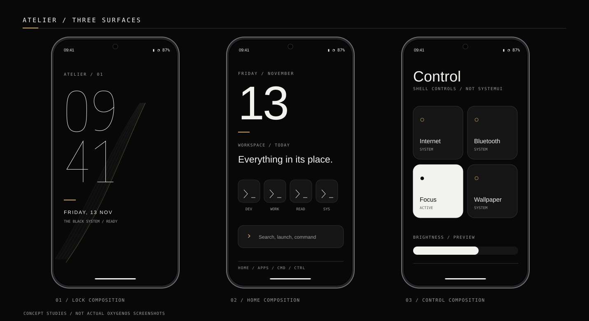
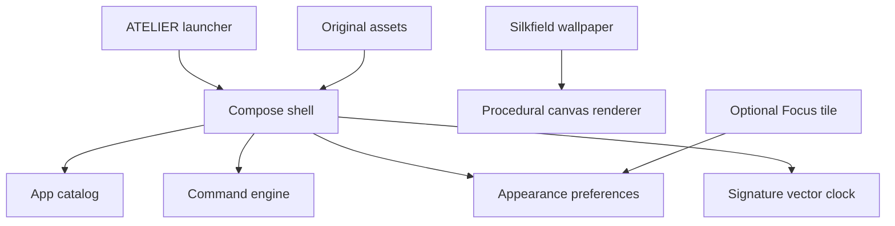

<div align="center">


# ATELIER
### THE BLACK SYSTEM

**A bespoke, typography-led Android launcher and visual identity for the OnePlus Nord 5.**

*Black is not a color choice here. It is the material.*

[Explore the interactive study](web/index.html) · [Architecture](docs/ARCHITECTURE.md) · [Design system](docs/DESIGN_SYSTEM.md) · [Roadmap](docs/ROADMAP.md)

</div>

---

## The proposition

ATELIER is an independent, open-source experiment in treating the phone as a carefully engineered instrument. Not an icon pack pasted onto Android. Not a fake terminal. Not another neon-black sci-fi interface.

The design is built on **near-black ink, architectural negative space, original vector clock numerals, extremely selective brass, restrained motion and a genuinely useful command layer**.

### Design principles

| Principle | Commitment |
|:--|:--|
| **Nothing decorative without purpose** | Motion and color explain state, focus or navigation. |
| **The clock is an object** | A custom-drawn, animated numeral system, not giant type. |
| **Quiet technology** | Developer tooling exists as useful interaction, not visual cosplay. |
| **Silence is premium** | Idle motion should be almost invisible; backgrounds stop when hidden. |
| **Reversible by default** | No root requirement, no replacement secure lock screen, no undocumented SystemUI hooks. |
| **One language, many surfaces** | Shared tokens for the launcher, wallpaper, command system, widgets and asset generation. |

## Surface studies



*Visual design studies only. The actual secure lock screen and full OxygenOS control shade remain outside the launcher’s control.*

## 01 / The material system

```text
INK          #080809      Primary background
CHARCOAL     #151516      Elevated surfaces
PAPER        #F2F2EE      Primary content
FOG          #9C9C9C      Supporting information
AU           #CDA664      Sparse accent, not body text
```

Type direction: **Hubot Sans** (display and UI), **Spline Sans** (longer copy), **Departure Mono** (commands and technical metadata). The signature numerals are custom vector paths and do not depend on licensed display fonts. Fonts may be supplied through their respective upstream sources; see [licensing](docs/LICENSING.md).

## 02 / What is implemented

> [!IMPORTANT]
> **Pre-alpha source, not a released APK.** The project is a native Android implementation in progress. Code is provided for review and testing; a successful Gradle build and physical Nord 5 test have not yet been verified.

| Module | Current state |
|:--|:--|
| Kotlin + Jetpack Compose launcher shell | **Implemented in source** |
| Installed-app discovery, app drawer and launching | **Implemented in source; device QA pending** |
| Command grammar and app search | **Implemented in source, with unit tests** |
| Vector-clock drawing and timed updates | **Implemented in source; motion tuning pending** |
| Local appearance / favorites / focus preferences | **Implemented in source** |
| Procedural `WallpaperService` | **Implemented in source; battery QA pending** |
| Opt-in Quick Settings focus tile | **Implemented in source; OEM QA pending** |
| Three original static wallpapers and SVG icon system | **Generated assets** |
| Browser-based multi-surface concept study | **Design prototype, not Android UI** |
| Secure lock screen / fingerprint / native notification shade | **OxygenOS-owned, not replaced** |

## 03 / Explore the visual study

Open [`web/index.html`](web/index.html) in a modern browser or serve the `web/` folder with a static file server. The browser experience is for reviewing hierarchy, motion and visual identity; it cannot launch Android applications or replace the system UI.

**What to inspect:** lock screen, home screen, command palette, application library, control surface and appearance presets. Compare every screen at phone width before proposing additional visual weight.

## 04 / Architecture



```text
app/
  src/main/
    AndroidManifest.xml
    java/dev/atelier/
      LauncherActivity.kt
      data/                 # App discovery and local preferences
      domain/               # Pure command parsing
      ui/                   # Compose shells, design tokens, clock
      wallpaper/            # Lifecycle-aware wallpaper service
      tiles/                # Optional Android Quick Settings tile
assets/
  icons/                    # Original vector source
  wallpapers/               # Procedural master artwork
web/                        # Interactive visual concept study
scripts/                    # Reproducible asset generation
docs/                       # Design, engineering and rollout notes
```

## 05 / Android setup

1. Install current Android Studio, Android SDK and JDK 17.
2. Open the repository as a Gradle project; allow Android Studio to resolve its declared Android Gradle Plugin, Kotlin plugin and Compose dependencies.
3. If `gradlew` is not present, install a compatible local Gradle distribution and generate a wrapper using `gradle wrapper`. A wrapper properties file alone does not make `./gradlew` executable.
4. Build and test with `assembleDebug`, install on a test device, then explicitly choose ATELIER as your HOME app if prompted.
5. Opt into the live wallpaper through the Android wallpaper picker; add the optional Focus tile separately.

**Safety:** Keep the stock OxygenOS launcher installed, and always test the HOME selection recovery route. This project never requests root or attempts to bypass the secure lock screen.

**Target:** OnePlus Nord 5, model CPH2707, OxygenOS 16. This is a device target, not a claim of device-level compatibility validation.

## 06 / Scope boundaries

ATELIER can own the home interface, its search and commands, app presentation, its own animations and a `WallpaperService`. The operating system still owns the secure lock screen, fingerprint UI, status-bar/system notification shade and most Quick Settings visuals. A tile is not a shade replacement.

## 07 / Design before polish

A beautiful empty screen is not enough. Every feature is evaluated against five questions:

- Does it improve clarity or interaction?
- Is its motion motivated by a real state change?
- Can it be paused, reduced or turned off?
- Will it remain readable on a 6.83-inch screen?
- Can it survive a normal OxygenOS update?

Current milestones live in [ROADMAP.md](docs/ROADMAP.md). Decisions and implementation restrictions live in [ARCHITECTURE.md](docs/ARCHITECTURE.md).

## Status and contributions

**Status: 0.1 pre-alpha.** Native source exists, but we are not claiming a release, audited privacy behavior or verified device performance. Issues, precise design critiques and reproducible device findings are welcome. Prefer a measured before/after result over aesthetic adjectives.

This repository is an independent community project, **not affiliated with or endorsed by OnePlus**. OnePlus, Nord, OxygenOS and other product names belong to their respective owners.

Code/artwork licensing is being finalized. Do not assume third-party fonts or icons are covered by the same license as project source; see [LICENSING.md](docs/LICENSING.md).
