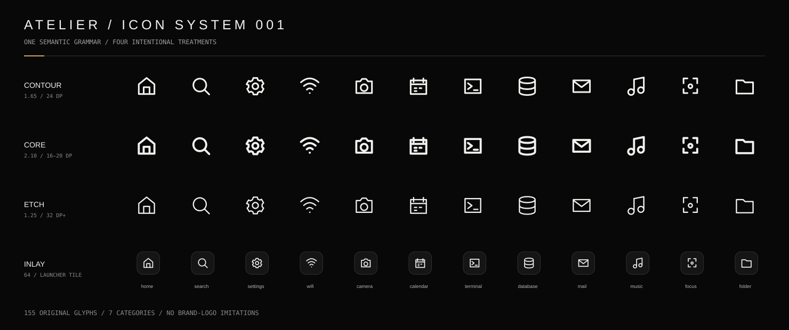

<div align="center">


# ATELIER

**THE BLACK SYSTEM**

A cinematic, dark-only Android launcher and live wallpaper, designed around an original visual language for the OnePlus Nord 5.

[**Download Android preview**](https://github.com/varunaditya27/oneplus-nord-5-themekit/releases/tag/v0.9.0-preview.2) · [**Explore the interface**](https://varunaditya27.github.io/oneplus-nord-5-themekit/) · [Motion Studio](https://varunaditya27.github.io/oneplus-nord-5-themekit/motion/) · [Icon Archive](https://varunaditya27.github.io/oneplus-nord-5-themekit/icons/)

<sub>v0.9.0-preview.2 · Kotlin / Jetpack Compose · Android 12+ · Debug-signed public prerelease</sub>

</div>

---

## An operating surface with its own character

ATELIER is not another wallpaper-and-icon swap. It's a custom Android **Home** experience whose clock, symbols, gestures, control surfaces, type and animation all speak the same visual language.

Near-black materials provide the stage. Ivory carries information. Antique brass appears only when something deserves attention. Motion gives every interaction physicality, without turning the UI into a light show.

<sub>Independent project. Not affiliated with OnePlus. Built for the Nord 5; physical-device verification is still pending.</sub>

## Inside ATELIER

| Surface | What it does |
| :-- | :-- |
| **The living canvas** | Three procedural scenes: **Silkfield**, **Strata** and **Eclipse**. Touch and wallpaper offsets add depth; rendering pauses when hidden or motion is disabled. |
| **The launcher** | Native Home, searchable app library, custom commands, settings and Focus controls. Horizontal and vertical navigation responds to your gestures. |
| **The icon language** | **155 original symbols**, with Contour, Core, Etch and Inlay exports. Choose original app art, monochrome adaptive icons, functional glyphs or lettermarks. |
| **The kinetic system** | Still, Signature and Expressive motion presets; interruptible presses, cinematic navigation, vector-clock reveals and semantic icon transitions. |
| **The instruments** | Native battery, memory and storage readouts, not fabricated dashboard statistics. |
| **The personal toolkit** | Pin apps, assign individual glyphs, adjust materials and haptics, then export/import your curated appearance as local JSON. |

### The visual language



[Explore all 155 symbols](https://varunaditya27.github.io/oneplus-nord-5-themekit/icons/) · [View the design system](docs/DESIGN_SYSTEM.md) · [Inspect the brand identity](docs/BRAND_IDENTITY.md)

The logo, wordmark, UI glyphs and clock numerals are original vector constructions. The wallpaper scenes are rendered programmatically, not played back as looping image files.

### Motion, without compromise

[**Open the interactive Motion Studio**](https://varunaditya27.github.io/oneplus-nord-5-themekit/motion/)

Try press physics, favorite-state inlays, Focus transitions, navigation, vector numerals, the Silkfield atmosphere and Play/Pause, Menu/Close and Sound/Mute states. The web study is an interactive **prototype**; the installable launcher has its own native Android implementations.

## Install the preview

1. **[Get v0.9.0 Preview 2 from GitHub Releases](https://github.com/varunaditya27/oneplus-nord-5-themekit/releases/tag/v0.9.0-preview.2)** and download `ATELIER-v0.9.0-preview.2-debug.apk`.
2. Install and open ATELIER. If you want to use it as your launcher, request the default **Home** role in ATELIER Settings. Android will ask for approval.
3. Explore the surfaces, select a scene, long-press apps to customize their glyphs and choose the motion personality that feels right.

**Reversible by design.** Keep the stock launcher installed. To return, use **Android Settings → Apps → Default apps → Home app** and select the OnePlus launcher. Use **EXPORT KIT** before uninstalling a debug build so your preferences survive.

[Full Nord 5 setup and recovery guide](docs/NORD5_SETUP.md) · [Download checksums](https://github.com/varunaditya27/oneplus-nord-5-themekit/releases/download/v0.9.0-preview.2/SHA256SUMS.txt)

> [!IMPORTANT]
> **Public preview, not a production-certified phone theme.** The release APK is debug-signed; future builds may have different signing keys. Android compilation, unit tests and emulator smoke checks pass, but OxygenOS/Nord 5 battery use, refresh-rate performance, gesture conflicts and accessibility need testing on physical hardware.

## What ATELIER can and cannot change

**ATELIER controls:** its own Home interface, live wallpaper, app grid, vector icon assignments, local Focus state, procedural visuals and launcher-owned interactions.

**Android/OxygenOS controls:** the secure lock screen, Always-On Display, fingerprint animation, notification shade, system font and native Quick Settings UI. ATELIER cannot replace those with ordinary launcher permissions, and does not ask for root or hidden OEM hooks.

## Engineering

| Layer | Implementation |
| :-- | :-- |
| App | Kotlin, Jetpack Compose, Android HOME role |
| Wallpaper | `WallpaperService` and procedural Canvas scene renderer |
| Preferences | Local state; JSON theme import/export using Android's document picker |
| Command engine | Explicit, allowlisted commands, never shell execution |
| Brand & icons | Source SVG paths, native VectorDrawables and a reproducible export pipeline |
| Web studies | Static HTML/CSS/JS and programmatically animated SVG/Canvas |
| Verification | Gradle unit tests, emulator UI smoke/screenshots, asset validation and web checks |

For a local build, install JDK 17 and Android SDK 36, then run:

```sh
gradle --no-daemon testDebugUnitTest assembleDebug
```

The test APK appears at `app/build/outputs/apk/debug/app-debug.apk`. The GitHub release supplies the packaged preview without requiring a local build.

**Verification:** [Android release workflow](https://github.com/varunaditya27/oneplus-nord-5-themekit/actions/runs/43571085242) · [Emulator smoke test](https://github.com/varunaditya27/oneplus-nord-5-themekit/actions/runs/43570929013) · [Test plan](docs/TESTING.md)

## Explore the project

| Start here | Go deeper |
| :-- | :-- |
| [Get started](docs/NORD5_SETUP.md) | Installation, launcher recovery and theme backups |
| [Brand identity](docs/BRAND_IDENTITY.md) | Monogram, wordmark, material system and export rules |
| [Architecture](docs/ARCHITECTURE.md) | Launcher structure, permission boundaries and wallpaper lifecycle |
| [Motion specification](docs/MOTION.md) | Interaction tokens, presets and accessibility |
| [Iconography](docs/ICON_SYSTEM.md) | The 155-symbol taxonomy, optical weights and exports |
| [Roadmap](docs/ROADMAP.md) | Implemented work versus device-testing milestones |
| [Changelog](CHANGELOG.md) | Published previews and project milestones |
| [Repository profile](docs/REPOSITORY_PROFILE.md) | GitHub About description, homepage, topics and admin setup |
| [Contributing](CONTRIBUTING.md) | Setup, engineering expectations and pull requests |

## Project status

**v0.9.0-preview.2 is publicly downloadable.** The source and release build have passed CI and emulator smoke testing. It remains a **preview** until the launcher's behavior has been validated on the actual OnePlus Nord 5, including power draw, thermals, OEM gestures, profile handling and accessibility.

Issues and focused pull requests are welcome. Please respect the project's original artwork, fonts and user data.

**Licensing:** a project-wide code/artwork license has **not yet been chosen**. Public source visibility is not permission to redistribute or relicense it. Bundled fonts have their own notices. See [Licensing and provenance](docs/LICENSING.md).

<div align="center">


<sub>ENGINEERED TO FEEL DIFFERENT.</sub>

</div>
