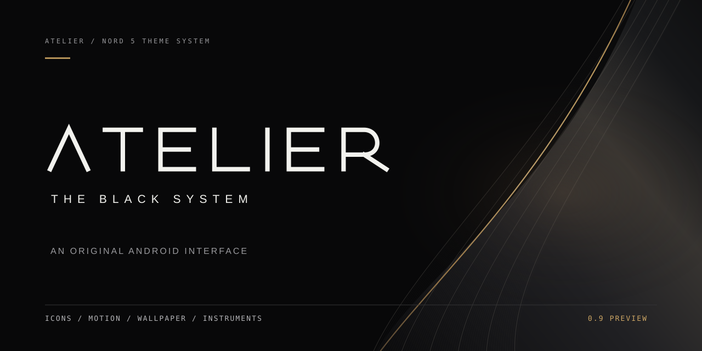
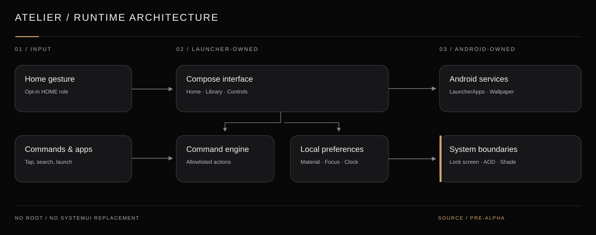

# ATELIER

**THE BLACK SYSTEM**

A typography-led Android launcher and visual theme kit for the OnePlus Nord 5.

0.9.0 PREVIEW 2 · ANDROID CI + EMULATOR QA VERIFIED · NORD 5 HARDWARE TESTING PENDING

[Public APK release](https://github.com/varunaditya27/oneplus-nord-5-themekit/releases/tag/v0.9.0-preview.2) · [Visual study](web/index.html) · [Motion Studio](web/motion/index.html) · [Explore 155 icons](web/icons/index.html) · [Design language](docs/DESIGN_SYSTEM.md) · [Build workflow](https://github.com/varunaditya27/oneplus-nord-5-themekit/actions)

## Why

Most custom Android themes change the wallpaper and icons while leaving the interaction model untouched. ATELIER treats the home screen as a complete interface: original vector clock numerals, functional application discovery, a precise command palette, expressive but purposeful motion and intentionally restrained materials.

It is not an OEM replacement. Android retains the secure lock screen, biometric interface and system notification shade.

## Principles

- **Subtract first.** If an element is neither useful nor legible, remove it.
- **Make time distinctive.** Draw clock numerals with original geometric paths instead of default fonts.
- **Give color a job.** Near-black ink and ivory do most of the work; antique gold marks deliberate states.
- **Let actions explain themselves.** Motion is short, interruptible and optional.
- **Keep developer behavior real.** Search and allowlisted commands replace decorative terminal jargon.
- **Preserve escape routes.** No root, no undocumented system hooks and no forced default-launcher takeover.

## The original ATELIER identity

A distinct crossbar-free architectural **A** and a precision-drawn wordmark form the official identity. These are **editable vector sources**, not crops of a concept presentation. The same form now appears in the Android launcher icon, the opening reveal, and the website.

[Logo](assets/brand/mark.svg) · [Wordmark](assets/brand/wordmark.svg) · [Lockup](assets/brand/lockup.svg) · [App icon](assets/brand/app-icon.svg) · [Repo cover](assets/brand/repo-cover.svg) · [Avatar](assets/brand/avatar.svg) · [Social card](assets/brand/social-card.svg) · [Splash](assets/brand/splash.svg) · [Brand guide](docs/BRAND_IDENTITY.md)

## The iconography system

**155 original functional drawings, 775 export-ready SVGs, and 465 Android VectorDrawables.** Four deliberate presentations are generated from the same reviewed source geometry: Contour for normal UI, Core for dense small controls, Etch for large editorial surfaces, and Inlay for launcher tiles. Active Inlay variants reserve a single gold mark for selection.

[Explore the searchable icon archive](web/icons/index.html) · [Browse the complete source catalog](iconography/catalog.json) · [Read the critical design audit](docs/ICON_AUDIT.md) · [See export instructions](docs/ICON_SYSTEM.md)

No recreated third-party logos: a generic repository icon is not a counterfeit GitHub logo. Brand-identifiable app icons remain available through Android's original-app-artwork option.

## The cinematic Android preview

The installable Android application now includes three original procedural wallpaper scenes (**Silkfield, Strata, Eclipse**), app-aware icon selection, a searchable glyph editor with persistent per-app overrides, physical drag-follow gestures, animated page choreography, three motion presets, real device gauges, and a native semantic-icon interaction gallery.

Wallpaper motion responds to scrolling and touch, while visibility, battery saver and reduced-motion controls prevent unnecessary rendering. The application does **not** replace OxygenOS's protected lock screen, fingerprint animations, AOD or notification shade.

[Latest build workflow](https://github.com/varunaditya27/oneplus-nord-5-themekit/actions/workflows/android.yml) · [Device installation and recovery](docs/NORD5_SETUP.md) · [Release notes](docs/RELEASE_NOTES.md)

Use **Settings → EXPORT KIT** to preserve the curated appearance and custom icons in a local JSON file. After an APK reinstall, use **IMPORT KIT** to restore everything without requiring an account. An optional one-time opening reveal can also be toggled in Settings.

## Motion and interaction

The kinetic layer combines non-bouncy press compression, quiet control-state transitions, short navigation crossfades, vector clock reveals, and a procedurally drawn Silkfield wallpaper.

The launcher includes three motion presets: **Still**, **Signature**, and **Expressive**. Reduced-motion preferences take priority. The wallpaper redraws only while visible, can become static, and respects Android power-saving mode.

[Open the interactive Motion Studio](https://varunaditya27.github.io/oneplus-nord-5-themekit/motion/) · [Read the motion specification](docs/MOTION.md) · [View canonical motion tokens](motion/tokens.json)

The browser study simulates Android UI states. It does not change OxygenOS settings or launch real apps.

## Architecture

Kotlin and Jetpack Compose own the launcher screens. Local preferences store appearance and Focus state; the command engine executes a small, explicit action vocabulary. A lifecycle-aware `WallpaperService` renders Silkfield, and an optional Quick Settings tile changes ATELIER's own Focus state, not Android Do Not Disturb.

## Status and installability

**ATELIER 0.9.0 Preview 2** has passed [Android unit tests and debug APK compilation](https://github.com/varunaditya27/oneplus-nord-5-themekit/actions/runs/43565347475). The [strict emulator smoke run](https://github.com/varunaditya27/oneplus-nord-5-themekit/actions/runs/43564888822) verified that the app starts, that Home, Library and Settings are distinct accessible screens, that no blocking emulator ANR dialog is present, and that the material stays dark in screenshots.

**This is not yet Nord 5 certified.** OxygenOS 16 compatibility, live-wallpaper behavior, thermals, performance under 120/144 Hz, accessibility and battery longevity require hardware testing. The debug APK has an ephemeral signing identity across CI runs.

[View the Android Actions workflow](https://github.com/varunaditya27/oneplus-nord-5-themekit/actions/workflows/android.yml) · [Emulator QA workflow](https://github.com/varunaditya27/oneplus-nord-5-themekit/actions/workflows/android-emulator.yml) · [Install and recovery instructions](docs/NORD5_SETUP.md).

The interactive [visual study](https://varunaditya27.github.io/oneplus-nord-5-themekit/), [Motion Studio](https://varunaditya27.github.io/oneplus-nord-5-themekit/motion/), and [icon archive](https://varunaditya27.github.io/oneplus-nord-5-themekit/icons/) are published on GitHub Pages.

## Documentation

- [Nord 5 setup](docs/NORD5_SETUP.md): install, customize, use gestures and restore OxygenOS.
- [Iconography system](docs/ICON_SYSTEM.md): symbol taxonomy, optical sizes, and exports.
- [Design system](docs/DESIGN_SYSTEM.md): color, typography, spacing, icons and visual restraint.
- [Architecture](docs/ARCHITECTURE.md): module responsibilities, permissions and Android boundaries.
- [Roadmap](docs/ROADMAP.md): completed source work and unverified device milestones.
- [Motion](docs/MOTION.md): how animations respond to state and respect reduced motion.
- [Testing](docs/TESTING.md): reproducible automated checks and Nord 5 acceptance criteria.
- [Publishing](docs/PUBLISHING.md): enabling GitHub Pages for the interactive study.
- [Licensing](docs/LICENSING.md): asset provenance and unresolved project license.
- [Glossary](docs/glossary.md): plain-language definitions of Android and design terms.
- [Brand identity](docs/BRAND_IDENTITY.md): original logo construction, sources, application and export rules.
- [Brand artwork](assets/brand/): original vector logo, wordmark, app icon, covers and interface studies.
- [Surface studies](assets/brand/surface-studies.svg): lock, home and control visual concepts.

## Contributing

Focused, testable improvements are welcome. Please read [CONTRIBUTING.md](CONTRIBUTING.md) and [SECURITY.md](SECURITY.md) before opening a change. For visual contributions, demonstrate the change at phone scale and explain the user-facing benefit.

## Licence

**Project licence not yet selected.** Source is public for evaluation; do not assume permission to redistribute or relicense it. Third-party font licences are separate, and proprietary fonts are not included. See [licensing notes](docs/LICENSING.md).

ATELIER is an independent project, not affiliated with OnePlus.

ATELIER / THE BLACK SYSTEM

