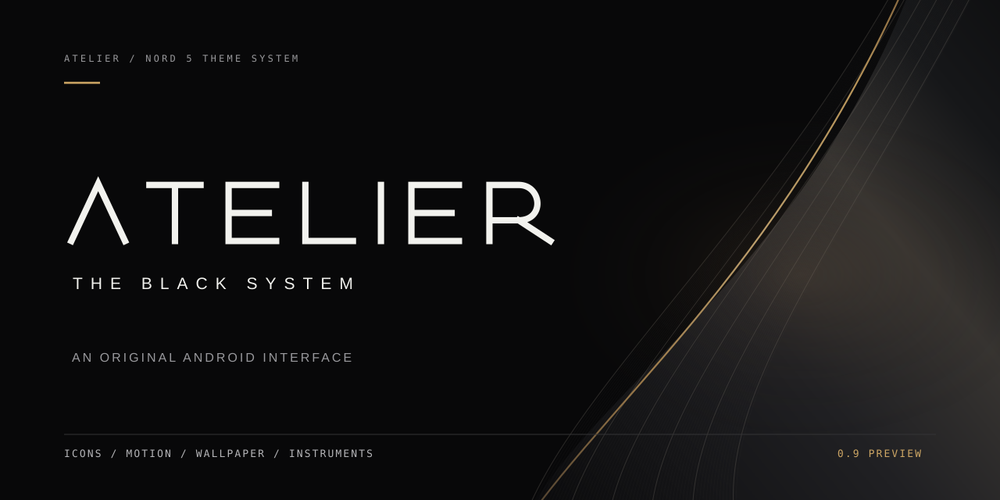

# ATELIER / Official brand identity

> **THE BLACK SYSTEM**. A cinematic, typography-led interface identity for an independent Android launcher.

## Master mark

The unbarred architectural A is constructed from two crisp ivory diagonals and one short antique-brass register line. The apex is deliberate, the interior remains open, and the register sits above the visual center. It is not a generic A with an added cursor or full crossbar.

- The transparent 256×256 SVG mark is the **single master**.
- Official geometry: white strokes `(42,170) → (113,28) → (184,170)` with 12.5-unit weight; brass register `(142,92) → (205,92)` with 7.5-unit weight.
- Keep clear space of **at least 18% of the mark's width** around the full symbol.
- Never stretch, rotate, skew, add neon glows, trace brand logos, or draw decorative lines through the core mark.
- The custom vector ATELIER wordmark uses geometrically drafted characters and has **no runtime font dependency**.

## Source assets

| File | Role |
| --- | --- |
| [mark.svg](../assets/brand/mark.svg) | Transparent, scalable primary monogram |
| [wordmark.svg](../assets/brand/wordmark.svg) | Geometric text, independent of fonts |
| [lockup.svg](../assets/brand/lockup.svg) | Wordmark with THE BLACK SYSTEM |
| [app-icon.svg](../assets/brand/app-icon.svg) | Matte launcher/social tile |
| [favicon.svg](../assets/brand/favicon.svg) | Small icon |
| [avatar.svg](../assets/brand/avatar.svg) | Circular profile image |
| [repo-cover.svg](../assets/brand/repo-cover.svg) | GitHub README cover, 1280×640 |
| [social-card.svg](../assets/brand/social-card.svg) | Social preview, 1200×630 |
| [splash.svg](../assets/brand/splash.svg) | Vertical phone splash, 1080×2400 |
| [pattern.svg](../assets/brand/pattern.svg) | Curves, frames and brass cuts |

The previous image-generation studies are **conceptual inspiration**. These exported SVGs are independently authored, editable implementation art and are the canonical assets to reuse.

## Palette and typography

| Name | Hex | Usage |
| --- | --- | --- |
| Obsidian | `#080809` | 85–95% of the visual plane |
| Raised Graphite | `#151516` | Depth without gradient cards |
| Ivory | `#F2F2EE` | Core mark and primary information |
| Antique Brass | `#CDA664` | Single deliberate accent |
| Quiet Grey | `#98989B` | Secondary metadata |

Wordmark uses original path geometry. Interface typography: bundled Hubot Sans (display), Spline Sans (content) and Departure Mono (technical labels). Do not substitute Neue Machina or other proprietary fonts without a license.

## Native and web integration

Android uses `app/src/main/res/mipmap-anydpi-v26/atelier_launcher.xml` referencing original foreground/monochrome VectorDrawable artwork. The Home launch sequence renders the same symbol using Compose Canvas. It is not a bitmap disguised as a native icon.

The static site serves the mark, favicon, and social card; SVG source lives in `assets/brand`. PNG and packaged release derivatives are produced by the brand export workflow.

## Export and licensing

Use `python scripts/brand/verify.py` to verify all SVGs. Use `python scripts/brand/export.py` to generate common raster sizes. Editable SVGs are the source of truth; never maintain PNG variants by hand.

This is original ATELIER artwork in a public repository, **not automatically an open license**. See [Licensing](LICENSING.md). ATELIER is not affiliated with OnePlus.
